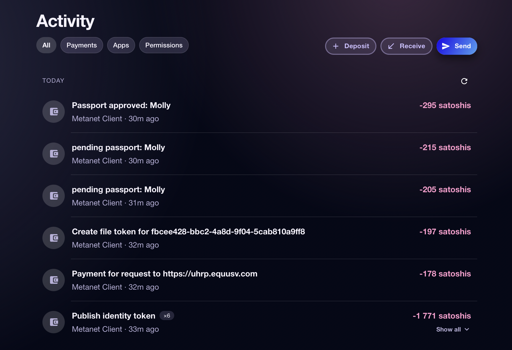
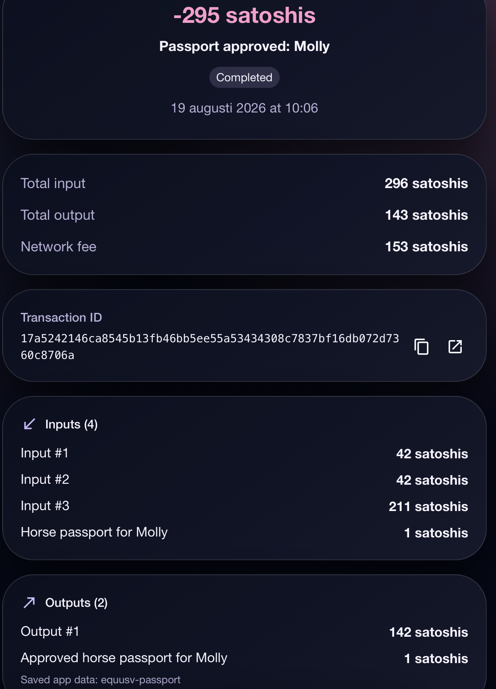
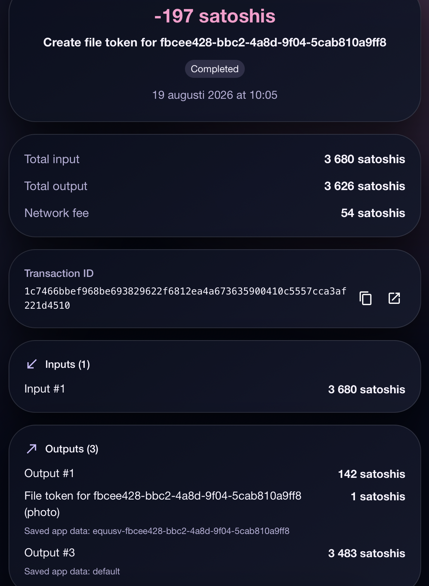

## Contents

1. [Project Overview](#1-project-overview)
2. [Demo](#2-demo)
3. [Clone and Setup](#3-clone-and-setup)
4. [Architecture](#4-architecture)
5. [Course Requirements Mapping](#5-course-requirements-mapping)
6. [Known Limitations](#6-known-limitations)
7. [Glossary](#7-glossary)

# 1. Project Overview

## EquusV: Tokenized Horse Journal

A cryptographically verifiable horse journal controlled by the horse owner.

### Background

EU Regulation 2021/963 requires a lifelong physical passport for every horse in the EU. Today's system is paper based and fragmented, making passports difficult to verify and their history difficult to trust. Information recorded on paper can be changed without detection.

The passport requirement itself is EU law and remains in place. The problem is the medium, not the requirement.

### Concept

EquusV is a digital journal for the horse's entire life. The passport forms the root of a token tree, with the horse's identity recorded on chain and anchored to the physical animal through its microchip number and UELN.

Each subsequent event in the horse's life, such as a farrier visit or veterinary visit, is added to the tree as its own token, gradually building a verifiable history.

The owner owns the entire tree. Journal data is timestamped and immutable on chain. Photos and documents are encrypted and stored off chain through UHRP.

The journal is shared with other stakeholders on a conditional basis. For example, the horse owner sends the horse passport to a breeding organization for official issuance and verification. The breeding organization has access to the horse's journal but can only see the information it has issued itself, without gaining access to the rest of the journal.

EquusV complements the physical passport. It does not replace it, since the physical document remains a legal requirement in the EU.

### Market

There are approximately 7 million equids in the EU, including horses, donkeys and mules. Sweden alone has around 355,000 registered horses.

The primary user is the horse owner. Breeding organizations are natural certifiers. Later phases include veterinarians, farriers, insurance companies, slaughterhouses, the Swedish Board of Agriculture and other stakeholders.

# 2. Demo

[Full walkthrough](https://uhrp.equusv.com/demo/demo.mov) — onboarding, passport creation, photo upload, submission and approval.

## On-chain activity

The same flow seen from the token-server wallet:



The approval transaction shows the state transition on-chain. The pending passport token is consumed as an input and an active token is minted as an output:



The UHRP file token, referencing the encrypted photo stored on the self-hosted host:



# 3. Clone and Setup

## Before you start: the mobile client

The mobile app is a React Native / Expo iOS development build. Building it requires an Expo account and Apple credentials for signing, which is why the demo is provided as a recording rather than an installable build.

For reference, the build and run commands are:

```bash
cd mobile
eas build --profile development --platform ios
bun run expo start --dev-client --clear
```

`EXPO_PUBLIC_*` variables are compiled into the build, so `mobile/.env` must point at the machine running the token-server and overlay before building.

A TestFlight build will be available once EquusV is incorporated and an Apple Developer account is in place.

## What the rest of this section covers

The server side runs from a clone with no native tooling. Starting the overlay and the token-server confirms that the system configures itself correctly: the overlay registers three topic managers and three lookup services against MongoDB, and the token-server loads its funded wallet and exposes its certifier identity.

Creating passports, certificates and photos is initiated from the mobile client, so a fresh clone starts with an empty index. The demo shows those flows end to end.

## Prerequisites

- **Docker** — runs the overlay and its MongoDB container
- **bun** — package manager and runtime
- **LARS CLI** — installed globally

No database setup and no native build tooling are required.

## 1. Clone and install

```bash
git clone https://github.com/covegi/equusv
cd equusv
bun install
```

## 2. Environment files

Copy the example files:

```bash
cp token-server/.env.example token-server/.env
cp mobile/.env.example mobile/.env
```

### The token-server wallet key

`EQUUSV_ROOT_KEY` is the private key for the token-server's wallet. It is deliberately **not** included in the repository, and `token-server/.env.example` ships with it empty.

The server refuses to start without it:

```
Error: EQUUSV_ROOT_KEY is required in token-server/.env
```

Generate a key for local use:

```bash
node -e "console.log(require('crypto').randomBytes(32).toString('hex'))"
```

Put the result in `token-server/.env`:

```properties
EQUUSV_ROOT_KEY=<your generated key>
```

The key only needs funding if you intend to create transactions on-chain, which is initiated from the mobile client. For starting the server and inspecting the system, an unfunded key is sufficient.

## 3. Start the overlay

From the project root:

```bash
bun run start
```

This starts LARS, which boots the overlay and its MongoDB container.

**What to look for.** The startup log should show three topic managers and three lookup services being configured, followed by the overlay listening on port 8080:

```
🗂️ Configured topic manager tm_horse_passport
🗂️ Configured topic manager tm_uhrp
🗂️ Configured topic manager tm_identity
🔍 Configured lookup service ls_passport with MongoDB
🔍 Configured lookup service ls_uhrp with MongoDB
🔍 Configured lookup service ls_identity with MongoDB
🎧 LARS is ready and listening on local port 8080
```

This is the overlay side of the three subsystems described under Architecture.

## 4. Start the token-server

In a second terminal:

```bash
cd token-server
bun run src/index.ts
```

**What to look for.** The wallet loads and prints the certifier identity key that the mobile client authenticates against:

```
Token-server identityKey: 029b5814b8e186b7c4a2499b88db258f03171fc773a46247409865f0232b02907f
token-server is running on port 3000
```

This identity key is the certifier for both role certificates, and matches `EXPO_PUBLIC_EQUUSV_IDENTITY_KEY` in `mobile/.env`.

## 5. Query the overlay directly

With both services running, the lookup services can be queried without the mobile client:

```bash
curl -X POST http://localhost:8080/lookup \
  -H "Content-Type: application/json" \
  -d '{"service":"ls_identity","query":{"subject":"<identityKey>"}}'
```

**What to look for.** A fresh clone returns an empty output list:

```json
{"type":"output-list","outputs":[]}
```

This is expected. The overlay indexes tokens as they are admitted, and nothing has been created yet on a new install. The response confirms that the lookup service is connected to MongoDB and answering in the correct format.

Against a populated index, the same query returns UTXO references for that subject's identity certificates, which the mobile client resolves into the name and role shown in the app.

# 4. Architecture

EquusV is a monorepo with three applications that together form the core system, plus a marketing frontend that is separate from the application logic.

## Applications

### mobile

React Native / Expo application used by the horse owner. It provides the wallet, onboarding and journal UI.

V1 is currently developed for iOS only.

The app holds the user's keys but no spendable satoshis. It reads token state from the overlay and internalizes tokens into the owner's wallet.

### token-server

Express service with the single funded wallet in the system.

It acts as the certifier, funder and broadcaster for on-chain actions on behalf of the user. It also handles UHRP uploads.

Every route is protected by BRC-103 mutual authentication.

### backend

BSV overlay node run by LARS.

It hosts three topic manager and lookup service pairs. It indexes on-chain tokens and answers discovery queries.

It holds no wallet.

### frontend

Vite / React marketing landing page.

It is currently separate from the application logic. A web GUI is planned for future development.

## The Three Subsystems

Each subsystem consists of one topic manager, one lookup service and one PushDrop token type.

### Identity

`tm_identity / ls_identity`

Self-custodied identity certificates for two roles, horse owner and breeding organization.

### Passport

`tm_horse_passport / ls_passport`

The horse passport token and root of the journal tree. It follows a pending to active lifecycle.

### UHRP

`tm_uhrp / ls_uhrp`

Encrypted photos and documents referenced by a token.

## Core Token Pattern

All three token types follow the same basic flow.

1. The client builds the PushDrop fields and locks them into an output.
2. `createAction` on the token-server wallet funds and signs the transaction.
3. The raw transaction is submitted to the overlay's `/submit` endpoint with an `X-Topics` header identifying the topic.
4. The topic manager validates the required fields and admits the output.
5. The lookup service indexes the output into MongoDB.
6. The mobile client discovers the token by querying the lookup service.

State machine tokens such as the passport additionally spend the previous output and mint a new one on each transition.

## System Flow

### Onboarding and Identity

A new user creates a wallet in the mobile app. A BIP39 mnemonic derives an HD key, which is stored in secure device storage and protected by a PIN.

On first run, the app acquires two identity certificates from token-server, one for the horse owner and one for the breeding organization, and publishes them to the overlay.

From that point, the app resolves identity keys to verified names and roles instead of displaying raw public keys.

### Creating a Passport

The owner enters the horse's official information, name, birth year, sex, breed, colour, owner, issuer and food chain status.

token-server mints the information as a pending passport token and funds the transaction.

The owner then internalizes the output into their own wallet in the passport basket with the tag `status:pending`.

### Adding a Photo

A photo is encrypted to the owner's key and uploaded to the self-hosted UHRP host.

token-server locks the storage reference into a UHRP token and submits it to the overlay.

The mobile app can later discover the token, fetch the encrypted file and decrypt it on-device for display.

### Submitting for Approval

The owner submits the passport to a breeding organization.

The organization reviews the passport in the horse's journal and either approves it or returns it for revision.

Coordination happens peer to peer through MessageBox. The two parties, each represented by a distinct identity key, exchange signed messages to coordinate the shared on-chain object.

### Approval and Activation

When the passport is approved, token-server spends the pending token and mints an active token. The owner is then notified through MessageBox.

The owner internalizes the active token and discovery now shows the passport as active.

The pending to active transition is a real on-chain state change. The old output is spent, a new output is minted and the status changes from `status:pending` to `status:active`.

In the current implementation, the owner receives approvals and revisions by manually refreshing the journal. There is no automatic push notification.

A revision is currently delivered only as a MessageBox message. The pending token remains unchanged on-chain and the revision comment is surfaced in the journal.

Moving revisions to their own on-chain state transition is planned for a later version.

### Ownership and Control

Throughout the system, the owner owns the tokens. They are internalized into the owner's wallet and ownership is expressed on-chain.

The owner does not yet have full control over the transaction lifecycle since funding and broadcasting are handled by token-server.

This is a deliberate V1 design choice and is explained further under Course Requirements Mapping, Statement 4.

# 5. Course Requirements Mapping

This section maps the EquusV implementation to each grading criterion. Where the implementation differs from the default approach, a short statement explains the reasoning, as permitted by the rubric.

## Criterion 1: Project Proposal

The approved proposal defines EquusV, originally proposed as EquusCert, as a tokenized horse passport on BSV using overlay services, PushDrop tokens, UHRP storage, identity certificates and peer to peer messaging.

This project implements that scope and extends it into the journal model described in the project overview.

## Criterion 2: User Authentication and Onboarding

### Authentication

Wallet based authentication uses a BIP39 mnemonic to derive an HD key. The key is stored in secure device storage and protected by a PIN.

All server requests use BRC-103 mutual authentication through `@bsv/auth-express-middleware`. Authentication is applied globally to every token-server route.

### Onboarding

The onboarding flow guides the user through the following steps:

1. Create or restore a wallet
2. Enter first and last name
3. Back up the mnemonic
4. Set a PIN
5. Acquire the two role certificates

The mobile client uses `AuthFetch` for authenticated requests.

## Criterion 3: Transaction Creation and Management

### Transaction Creation

On-chain actions use `createAction` on the token-server wallet. This includes identity publishing, passport minting, passport approval and UHRP file token creation.

Tokens are internalized into the owner's wallet using `internalizeAction`.

### State Management with Baskets

The passport basket holds each horse's passport token.

The passport follows a lifecycle using the tags `status:pending` and `status:active`, with the status associated with each horse.

### State Synchronization with Overlay Services

Three topic manager and lookup service pairs index admitted outputs into MongoDB and provide discovery:

- `tm_identity / ls_identity`
- `tm_horse_passport / ls_passport`
- `tm_uhrp / ls_uhrp`

The mobile client synchronizes token state by querying these lookup services.

## Criterion 4: Peer to Peer Messaging and Identity Resolution

### Messaging

See Statement 1.

### Identity Resolution

Identity certificates are self-custodied MasterCertificates published under `tm_identity` and indexed by subject.

The mobile client resolves an identity key to its certificate through `ls_identity`, decrypts the revealed fields and displays the verified name and role.

Raw public keys are never shown to the user. The resolved certificate is displayed in the identity card using live data.

See Statement 2 for the reasoning behind the direction of identity resolution.

### Statement 1: Peer to Peer Messaging

EquusV uses `MessageBoxClient` from `@bsv/message-box-client` rather than PeerServ directly.

The messaging requirement is asynchronous coordination between two parties who may not be online at the same time. A horse owner submits a passport for approval and a breeding organization later approves it or returns it for revision.

Two message boxes carry this flow:

- `equusv_active` allows the breeding organization to notify the owner that an approved active passport token is ready to internalize.
- `equusv_revisions` allows the breeding organization to return a passport with review comments.

Messages are listed, consumed and acknowledged by the recipient.

MessageBoxClient provides the mutually authenticated asynchronous delivery required for this pattern.

The interaction is peer to peer at the application level. Two distinct identity keys exchange signed messages to coordinate a shared on-chain object, with no central party mediating the message content.

### Statement 2: Identity Resolution Direction

EquusV implements identity resolution as key to attribute resolution.

Given an identity key, the app discovers that key's certificate through `ls_identity` and decrypts the revealed fields such as name, role and organization for display.

The reverse direction, attribute to key discovery, is not required by the V1 flows. Every interaction begins with a known identity key, either the user's own key or a counterparty's key established through the passport approval flow.

Resolution therefore always moves from a known key to its attributes.

Attribute based search could be added in a future version with a public directory of participants. It does not add value to the V1 use case because the keys a user interacts with are determined by the workflow.

## Criterion 5: Content Management and UHRP Hosting

### Upload and Download

When a photo is uploaded, it is encrypted to the owner's key using ECIES and uploaded through `StorageUploader`.

The resulting reference is locked into a PushDrop token and submitted to `tm_uhrp`.

When the photo is downloaded, the client discovers the token through `ls_uhrp`, fetches the encrypted file and decrypts it on-device.

### UHRP Hosting

Content is stored on a self-hosted UHRP host at `uhrp.equusv.com` rather than on a third party hosting service.

## Criterion 6: Tokenization and Custom Instructions

### Token Creation with PushDrop

EquusV implements three PushDrop token types:

- Passport token
- UHRP file token
- Identity certificate token

The passport token contains 18 positional fields and implements a full mint, spend and re-mint state machine.

Token identity and state are carried in the decoded PushDrop fields and basket tags.

### Custom Instructions

See Statement 3.

### Statement 3: Custom Instructions

EquusV carries token state and identity in decoded PushDrop fields and basket tags rather than in `customInstructions` metadata.

Each passport token encodes its state in 18 positional PushDrop fields, including version, status, identity key and the horse's attributes.

Its lifecycle is tracked through basket tags that move from `status:pending` to `status:active` as the token is spent and re-minted.

Token identification and filtering throughout the app are driven by these fields and tags. This is where token history and state transitions are tracked.

In EquusV, the role that custom instructions could play is handled by the on-chain PushDrop fields combined with baskets and tags for local indexing.

Keeping state in the token's own fields keeps the source of truth on-chain and verifiable by any party. This is important for a system focused on data integrity across multiple stakeholders.

Custom instructions were therefore not required for the token interactions implemented in EquusV.

## Criterion 7: Payment Handling and Backend Management

### Client Side Payment

See Statement 4.

### Backend Wallet Management

The token-server wallet is the single funded wallet in the system.

It funds and broadcasts every on-chain action on behalf of the user, including identity publishing, passport minting, passport approval and UHRP file token creation.

It also authenticates uploads to the UHRP host.

The wallet is initialized from a server-held root key and performs startup cleanup of stuck actions.

### Statement 4: Payment Model

EquusV V1 uses a custodial payment model.

The token-server wallet funds and broadcasts on-chain actions on behalf of users. The mobile client holds no satoshis.

This is a deliberate V1 design decision.

Custody here applies to payment and transaction broadcasting, not to ownership. Users own their tokens. Passport tokens are internalized into the user's own wallet, meaning the user holds the outputs on-chain.

The token-server provides funding and broadcasting, not custody of the user's assets.

The purpose of EquusV V1 is twofold. It meets the Metanet Academy final project criteria and serves as a proof of concept for a production system for the equine industry.

In that context, requiring end users, hobby riders, breeders and stable owners to acquire satoshis and manage a wallet balance would add onboarding friction to a market that is not yet mature for Web3.

Expecting users to understand wallets, transactions and satoshis is a broader education problem that sits outside the problem EquusV is designed to solve.

EquusV applies BSV to concrete industry problems such as stakeholder coordination, data integrity and identity.

Abstracting away satoshi handling so that the user never sees a balance or payment is therefore the appropriate product choice for V1.

Payment occurs server side. The token-server wallet pays for funded actions, including actions such as `StorageUploader` paying the UHRP host during file uploads.

When the market is ready for self custody, the app can be rebuilt to move funding and broadcasting to the client while keeping the same ownership model.

## Criterion 8: Documentation and Presentation

This README provides the project overview, a recorded demonstration of the complete flow, setup instructions, the architecture, this requirements mapping, known limitations and a Swedish-English glossary for the interface.

# 6. Known Limitations

The following are known limitations in V1. They are documented here for transparency.

## UHRP Advertisements

The self-hosted UHRP host stores and serves files correctly. Uploads are encrypted, stored and retrievable through the CDN, and the corresponding PushDrop token is minted and indexed on the overlay.

The host's own on-chain UHRP advertisements are currently not being published. Its wallet creates the advertisement transactions, but they do not reach the network. As a result, unconfirmed transactions accumulate until the BEEF depth limit is reached.

The upload path has been made resilient to this issue, so a failed advertisement no longer blocks storage.

This affects the host's own registry of the files it stores. It does not affect EquusV's file tokens, which are minted by token-server and indexed through `tm_uhrp` as intended.

A fix to the broadcast configuration in the host's wallet storage layer is pending.

## Passport Revisions

A revision is currently delivered only as a MessageBox message. The pending token remains unchanged on-chain.

When the owner resubmits after a revision, a new pending token is minted. The previous token is not always spent, which can result in more than one pending token for the same horse.

Moving revisions to their own on-chain state transition is planned for a later version.

## Manual Refresh

Approvals and revisions are currently received by manually refreshing the journal.

There are no push notifications, and the breeding organization's queue is loaded once when the view is opened.

## Chaintracker Rate Limits

The overlay verifies merkle roots against WhatsOnChain's public API, which is rate limited. Under sustained use the limit is reached and transaction submissions are rejected with a verification error, even though the transactions themselves are valid and broadcast to the network.

Configuring a dedicated ARC endpoint or a self-hosted headers service removes this dependency. This is a configuration change rather than a code change, and is required before the system can carry production load.

# 7. Glossary

The mobile interface is in Swedish. This glossary maps the terms shown in the app and in the demo to English.

## Domain terms

| Swedish | English | Note |
|---|---|---|
| Hästpass | Horse passport | The EU-mandated lifelong document for a horse |
| UELN | UELN | Universal Equine Life Number, 15 digits, assigned by the issuing organisation |
| Chipnr | Microchip number | 15 digits, the physical identifier implanted in the horse |
| Avelsorganisation | Breeding organisation | Issues and verifies passports on behalf of the authority |
| Hästägare | Horse owner | |
| Livsmedelskedjan | Food chain | Whether the horse is intended for human consumption; a legal status that affects permitted medication |
| Ingår / Ingår ej | Included / Not included | Food chain status |
| Jordbruksverket | Swedish Board of Agriculture | The national authority for equine registration |
| Stall | Stable | |
| Signalement | Description of markings | Physical identification used alongside the microchip |

## Horse attributes

| Swedish | English |
|---|---|
| Namn | Name |
| Ras | Breed |
| Kön | Sex |
| Född / Födelsedatum | Born / Date of birth |
| Färg | Colour |
| Ägare | Owner |
| Ort / Plats | Location |
| Organisation | Organisation |

**Sex:** Hingst = stallion, Sto = mare, Valack = gelding

**Breeds:** Svenskt varmblod = Swedish Warmblood, Svenskt fullblod = Swedish Thoroughbred, Nordsvensk = North Swedish Horse, Gotlandsruss = Gotland Pony, Islandshäst = Icelandic Horse, Connemara, Welsh, Shetlandsponny = Shetland Pony

## Passport status

| Swedish | English | Meaning |
|---|---|---|
| Utkast | Draft | Created locally, not yet submitted |
| Skickat | Submitted | Sent to the breeding organisation |
| Mottaget | Received | Visible in the organisation's queue |
| Väntar på granskning | Awaiting review | |
| Revision | Revision | Returned to the owner for correction |
| Återsänd | Returned | |
| Aktivt | Active | Approved and issued |
| Inaktivt | Inactive | No longer valid |

## Verification status

| Swedish | English |
|---|---|
| Ej verifierat | Not verified |
| Väntar på verifiering | Awaiting verification |
| Verifierat | Verified |
| Självdeklarerat | Self-declared |

## Journal categories

| Swedish | English |
|---|---|
| Alla | All |
| Identitet | Identity |
| Hälsa | Health |
| Avel | Breeding |
| Livscykel | Life cycle |
| Aktiviteter | Activities |

## Identity and certificates

| Swedish | English |
|---|---|
| Certifikat | Certificate |
| Certifierare | Certifier |
| Innehavare | Holder |
| Roll | Role |
| Certifikat-ID | Certificate ID |
| Hästägarcertifikat | Horse owner certificate |
| Avelsorganisationscertifikat | Breeding organisation certificate |
| Återställningsnyckel | Recovery key | The BIP39 mnemonic |
| Arkiv | Archive | The user's wallet and journal, referred to as an archive in the interface |

## Actions

| Swedish | English |
|---|---|
| Skapa | Create |
| Spara utkast | Save draft |
| Spara ändringar | Save changes |
| Redigera | Edit |
| Radera / Ta bort | Delete |
| Skicka | Send |
| Skicka igen | Send again |
| Skicka till avelsorganisation | Send to breeding organisation |
| Skicka revision | Send revision |
| Godkänn | Approve |
| Godkänn ansökan | Approve application |
| Återkalla / Dra tillbaka | Withdraw |
| Avbryt | Cancel |
| Fortsätt | Continue |
| Återställ | Restore |
| Uppdatera | Refresh |
| Välj | Select |
| Lägg till | Add |

## Onboarding

| Swedish | English |
|---|---|
| Skapa nytt arkiv | Create new archive |
| Återställ arkiv | Restore archive |
| Vad heter du? | What is your name? |
| Förnamn / Efternamn | First name / Last name |
| Skapa din PIN-kod | Create your PIN |
| Bekräfta din PIN-kod | Confirm your PIN |
| Din återställningsnyckel | Your recovery key |
| Jag har sparat min nyckel | I have saved my key |
| Dela aldrig denna nyckel med någon | Never share this key with anyone |

## Interface messages

| Swedish | English |
|---|---|
| Inga hästar ännu | No horses yet |
| Inga inkomna ärenden | No incoming cases |
| Passansökan | Passport application |
| Ärende | Case |
| Hämtar bild... | Loading image... |
| Sparar bild... | Saving image... |
| Skickar... | Sending... |
| Konfigurerar... | Configuring... |
| Något gick fel | Something went wrong |
| Behörighet saknas / krävs | Permission missing / required |
| Kameraåtkomst krävs | Camera access required |
| Öppna inställningar | Open settings |
| Ta foto | Take photo |
| Välj från galleri | Choose from library |

## Taglines

| Swedish | English |
|---|---|
| Sanningen om din häst | The truth about your horse |
| Hela hästens liv i en journal | The horse's entire life in one journal |
| All historik — spårbar, delbar, verifierad | Full history: traceable, shareable, verified |
